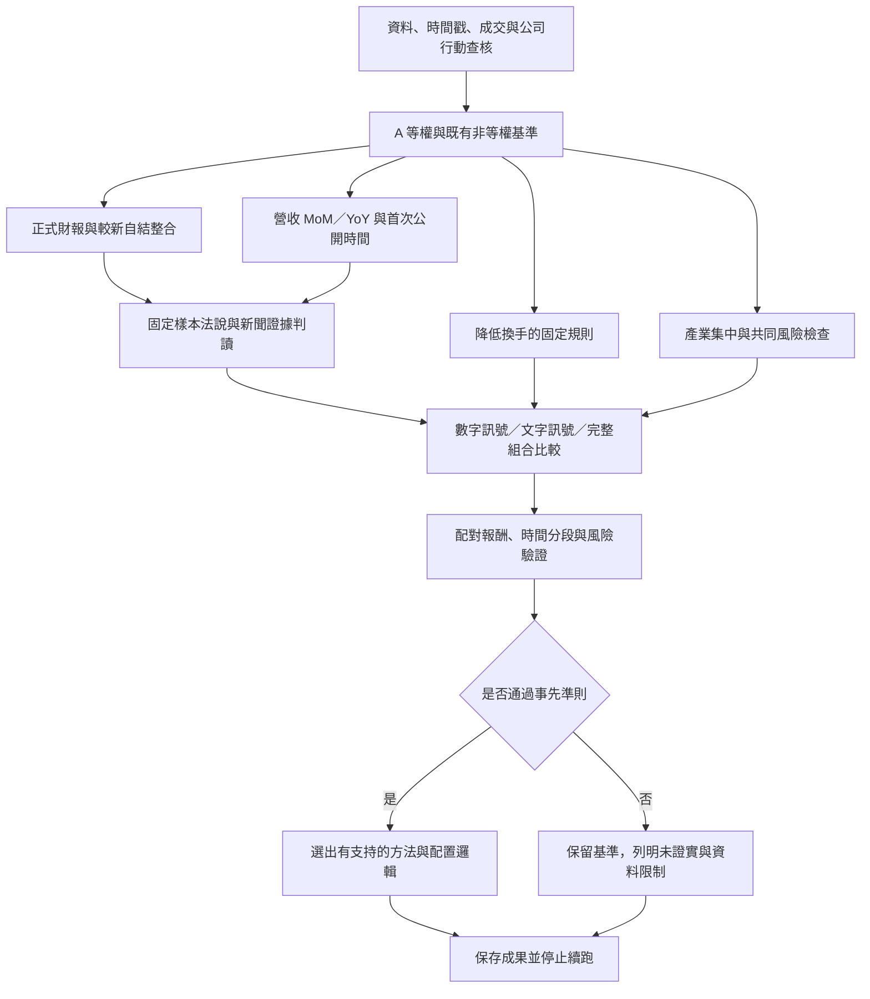

# A 策略無人值守研究流程

## 新增策略研究範圍：A失效原因與對應改善（2026-10-15）

使用者明確要求將「行情反轉、追高與產業集中、換手成本」加入後續研究。此為新增研究授權，接續v7；下文「有限研究收斂」是上一批結論，不阻止本批工作。②帳戶與D-Plan、③官賽規則、④流程演練仍延後；LLM仍暫緩。此次只登記研究範圍與依賴，尚未執行以下新診斷／新策略回測。

目標是分清A在何種情況失效，再用可在決策當下取得的資訊改善。失效診斷可用事後24日結果作應變數；交易規則只能用決策前資訊，不能拿窗口中已發生的反轉或最終虧損決定初始權重。使用v7已驗證快照／引擎與原Notebook，不另建Project或重抓成功來源。

|分支|先做的診斷|對應策略候選|定義及資料邊界|
|---|---|---|---|
|R：行情反轉|A虧損是否集中於市場由漲轉跌或強勢股同步轉弱；分開報酬、回撤與市場曝險，檢查跨年一致性|A加事前趨勢／風險狀態條件|指標、回看長度、觸發門檻、權重處置均須先固定，不能依回測最佳值選。首先維持25檔、總投入90%，只研究股間權重處置；若要提高現金／整體降曝險，另列不同研究條件，不悄悄改90%投入或宣稱已有驗證。無即時可用狀態訊號則不產生策略。|
|E：追高|開賽前動能、短期漲幅與波動是否能解釋後續24日虧損；不可因漲多就預設一定反轉|A限制過度延伸股票的投入權重|保持A選出的同25檔，先比較調權，不自動改成剔除／換股或減少檔數。過熱定義、上下限及回配方式事先固定，與普通動能加權區分，未知不能當過熱。|
|S：產業集中|虧損是否來自同產業股票同步下跌，及其對組合風險的貢獻|A加產業集中度限制|先查歷史有效分類；今日分類不能回填歷史。指數季節性結果不能代替個股歷史分類。若無歷史分類，標為受阻；相關性分群只能另列為統計共同風險診斷，不冒稱產業。可行時固定產業上限與原25檔間回配規則，不減少持股檔數。|
|T：換手成本|分開新進／退出與保留股微調的毛收益、費稅、換手，檢查每五日交易是否帶來足夠增量|優先沿用A溫和動能＋0.5%前日可交易NAV小額略過，必要時再定義單一額外規則|v7已有同一定義的650窗口結果，直接引用，不另重跑或當成新增策略。先診斷哪類交易耗費成本；若另測調整條件或週期，必須單獨固定定義並明示與原每五日執行的差異，不展開週期／容忍帶參數網格。|

「追高與產業集中」分成E／S兩個可區辨機制，因此三個討論方向實作為四個分支；不把兩者一次混入以致無法歸因。流程為：資料／可用性查核→失效診斷→固定單一候選定義→單獨與A及暫定非等權配置比較→統一統計。單獨機制沒有穩健證據前，不自動新增全部混合策略。

比較沿用：25檔、24交易日滑動窗口、每五日調整、90%投入、整千股與完整費稅；費用後同日期配對、24／48日區塊、多重比較、年份／時間分段、回撤與尾端損失並列。不得把重疊窗口視為獨立、兩年同季當穩定季節性，或已看過歷史稱未見樣本外。新增比較須納入既有選模次數，不以新家族抹去過去試驗。

去重：以實驗定義、參數、資料快照、引擎版本為鍵。v7相同結果直接引用；診斷與新策略分開標記。來源不足保留不可判定；資料改變只重算受影響部分並記原因。每個分支最後可為完成／未證實／不可判定，不保證一定有勝者。排程目前保持暫停；本節不是已啟動的背景執行。

---

## 現行範圍：第①項查核完成，回到策略討論（2026-10-15）

[最新v7資料缺口與策略比較](../90_%E6%AD%B7%E5%8F%B2%E5%A0%B1%E5%91%8A/%E5%A0%B1%E5%91%8A/A%E7%AD%96%E7%95%A5_%E9%97%9C%E9%8D%B5%E8%B3%87%E6%96%99%E7%BC%BA%E5%8F%A3%E8%88%87%E7%AD%96%E7%95%A5%E6%AF%94%E8%BC%83_v7_2026-10-15.md)。修正574筆原時間格式、有限更正範圍與8筆休市公司行動；A有效557窗口，兩年初始A25各24檔可核對。固定方法同引擎重驗證仍無已證實改良。12筆有償認購及未解原文仍保留限制。

使用者所指1／2／3／4是四件待辦表：只做①補資料缺口，②帳戶與D-Plan、③官賽規則、④流程演練全部延後。DataPack不是目前策略討論的阻礙。LLM暫緩；未新增策略參數或交易。PAUSED，kernel保留；舊「下一步等DataPack」段落不是現行優先順序。

## 新增待作：產業季節性加入報告與策略驗證（2026-10-15）

依使用者本次要求，將「產業漲跌幅加入說明」與「測試產業資訊是否改善策略」列為新待作。這是前輪研究收斂後新增的有限範圍，取代下文舊計畫對「產業交易權重不納入本輪」的排除；不重新開啟其他已停止或暫緩的分支。

**目前狀態：待執行。** 本次只更新清單，未新增回測、未改選股／權重、未更新已發布網站、未恢復排程。LLM暫緩與等待官方DataPack的安排維持原狀。既有v6財務／自結研究與離線驗證結果沿用，不重跑已完成工作。

| 編號／狀態 | 待作 | 完成標準 |
|---|---|---|
| S1・待作 | 將產業研究加入組員報告 | 在白話說明旁加入既有產業含息互動表與逐年資料點，解釋24交易日取法、相對大盤、含息／未含息、缺值與年份覆蓋。明列這是上市產業指數觀察，不是150檔策略報酬；保留虧損年份，不把背景觀察寫成已有效的交易規則。 |
| S2・待作 | 查核產業訊號的歷史可用性 | 為各歷史決策日起點列出可用的更早年度、有效年數、產業指數與個股分類對照；2024決策只能用2023及更早已知資料，不得用2016～2025全期統計回填。產業成分、名稱或分類無法驗證時，標示缺口，不直接把今日分類回填。區分季節性訊號與近期產業動能，避免同時改兩種因素。 |
| S3・待作；依賴S2 | 固定一個最小產業調權方案及對照 | 先寫明使用哪些產業統計、最低歷史年數、相對大盤或絕對報酬口徑、訊號方向、加減權規則／上限、缺資料中性與更新頻率，再看新績效。優先保持A選出的25檔不變，只測產業資訊調權；A等權作控制、既有溫和動能＋小額略過作參考，對照須能拆出產業資訊的增量，不大量搜尋倍率／門檻或只挑過去最強產業。此為實驗設計待作，尚未決定公式。 |
| S4・待作；依賴S2、S3 | 在既有Jupyter kernel完成有限回測 | 先恢復kernel狀態與必要物件，重用已驗證來源／引擎；採相同日期、24交易日、費用、整張、資金及既有合規限制，明確記錄排除原因。以時間順序逐年只用當時可知的產業歷史。資料不足則回報不可判定，不造分類或擴大至其他無關策略。 |
| S5・待作；依賴S4 | 比較結果與有效性 | 比較費用後報酬、同日期相對A差、回撤、虧損尾端、交易成本、換手與產業集中。保留各年度結果與所有有效資料點；若只有少數同季年份，不把重疊窗口當獨立年度，不宣稱穩定季節優勢。新增候選納入適當多重比較，已看過的資料不稱未見樣本外。結論可為支持、僅暫定、未證實或資料不足。 |
| S6・待作；依賴S1、S5 | 更新組員報告、互動圖與公開網站 | 加入「原A／加入產業資訊」的逐窗口或逐年度互動比較及白話解讀，清楚區分產業指數背景圖與可交易組合結果。回測無改善也如實呈現；完成內容與互動驗證後，沿用既有Sites網址與使用者已確認的公開權限更新，不另建網站。 |

執行順序：S1可先做，S2 → S3 → S4 → S5 → S6；S1、S5完成後才可將產業交易效果寫入最終說明。這份清單不代表已採用產業加碼，也不替團隊定案。必要資料無法驗證時完成可行項目、保存不可判定結論並停止，不為了選出勝者持續加參數。原研究其他分支不因本清單自動恢復。

## 官方資料開放前準備：D-Plan離線驗證原型（2026-10-15）

[驗證說明與35個案例](../90_%E6%AD%B7%E5%8F%B2%E5%A0%B1%E5%91%8A/%E5%A0%B1%E5%91%8A/TEAM_11693_DPlan%E9%9B%A2%E7%B7%9A%E9%A9%97%E8%AD%89%E8%AA%AA%E6%98%8E_2026-10-15.md)。在原Notebook內完成官方schema4.3、引用、時點、帳戶缺漏、千股、公式股數及預估資金檢查。測試是明確標示的軟體案例，不是歷史行情、真正DataPack或正式D-Plan。所有結果ready_to_submit仍false，來源內容／Active Share／官方規則及成交層待核對。實際帳戶演練等待主辦方DataPack開放；研究參數與LLM暫緩決定不變，排程保持暫停。

## 研究收斂（2026-10-15）：停止新增實驗，保留未證實結論

[決策表、固定暫定規格與採用條件](../90_%E6%AD%B7%E5%8F%B2%E5%A0%B1%E5%91%8A/%E5%A0%B1%E5%91%8A/A%E7%AD%96%E7%95%A5_%E5%85%AC%E5%91%8A%E6%9C%9F%E9%96%93%E8%88%87%E8%87%AA%E7%B5%90%E6%95%B4%E5%90%88%E7%A0%94%E7%A9%B6_v6_2026-10-15.md)。沒有已證實優於A的方法。A等權保留比較基準，A溫和動能＋小額略過只作符合第一天非等權需求的暫定研究候選；不是正式上場決策。參數未改，未新增回測／策略。LLM暫緩；來源缺口仍保留。等待主辦方DataPack開放後接TEAM_11693帳戶與D-Plan離線驗證；排程保持暫停，無執行中工作。

## 最新v6：季度自結與公告分類修正完成（2026-10-15）

[完整報告、兩年25檔權重與所有點](../90_%E6%AD%B7%E5%8F%B2%E5%A0%B1%E5%91%8A/%E5%A0%B1%E5%91%8A/A%E7%AD%96%E7%95%A5_%E5%85%AC%E5%91%8A%E6%9C%9F%E9%96%93%E8%88%87%E8%87%AA%E7%B5%90%E6%95%B4%E5%90%88%E7%A0%94%E7%A9%B6_v6_2026-10-15.md)。全150檔／673歷史日一致處理，2025 A25可核對季度本業由12增至23；6223更正及2337基礎不足保持中性。兩種受影響配置各650窗口、535配對，均有219窗口改變；固定原權重／費用，26家族校正未證實改良。相同動能比重對照之資訊增量約+0.0049pp，區間跨零。

單月注意損益及單位更正另存附表，不冒充季度本業資料。未解析季度／更正仍明列未知。LLM依使用者要求暫緩；TEAM_11693等待主辦方開放DataPack。此輪有限修正與可行統計／圖表完成，PAUSED，kernel保留；下文v5與早期「最新」保留作歷史。

## 本輪執行結果 v5：數值原型完成，LLM依使用者要求暫緩

[完整結果與剩餘限制](../90_%E6%AD%B7%E5%8F%B2%E5%A0%B1%E5%91%8A/%E5%A0%B1%E5%91%8A/A%E7%AD%96%E7%95%A5_%E9%96%8B%E8%B3%BD%E5%89%8D%E8%B3%87%E8%A8%8A%E8%AA%BF%E6%AC%8A%E7%A0%94%E7%A9%B6_v5_2026-10-14.md)。全150檔34,379原公告一致查核，正式財報／營收／組合三個開賽前固定訊號原型各650窗口、535與A配對；控制組精確重現v4。24家族校正未證實任何改良。匹配50%動能的對照後，資訊增量平均僅+0.0042pp、區間跨零。較新自結／更正仍保留未解析限制，不稱全部公告完成。

使用者本輪要求LLM先不測；50原文資料包保存但未產生LLM權重。團隊TEAM_11693，10組歷史開賽股數／資金機械檢查完成，正式帳戶／Active Share／D-Plan待官方DataPack。現行狀態以此節與state.continuation_plan_v5為準；排程保持PAUSED，無執行中工作，kernel保留。下列六階段為計畫與歷史定義，不把尚未通過的官方门檻偽稱完成。

## 現行完整計畫：六個主要階段（2026-10-14，待執行計畫）

本節統一後續範圍；下文歷次「最新／下一步」均為歷史紀錄，不另外累加成待辦。使用者本次要求先看完整計畫，因此本次只保存計畫，不新增回測、不恢復排程。六個階段是工作分類，不是六個已排程工作；既有研究結果保持完成／帶限制狀態。20分鐘仍只作喚醒間隔，不是任何階段的執行期限。

**目標**：固定以A動能選出的25檔，研究開賽前已公開資訊是否能改善第一天的非等權投入；最後提出有證據支持、僅暫定或未證實改良的結論。不以最高歷史報酬強選方法。24交易日、每五日調整、投入90%、整千股及既有費稅維持一致；AH僅作對照。

**已完成，直接沿用**：15種廣泛窗口方法，每種保存650個候選窗口，A有535個有效窗口；6種公告調權原型僅有兩年同季案例，不是每種650個有效窗口。官方公司行動已套用42筆可驗證修正；產業季節性觀察、3檔公告原文案例、2025開賽A25資訊新鮮度查核已有成果。目前沒有通過完整統計準則的A改良方法；A溫和動能＋小額略過只有暫定正向訊號。質性案例不是LLM調權回測。

| 階段 | 要做的事 | 完成標準與交付 |
|---|---|---|
| 1．統一資料與時間查核 | 將已驗證的中文年份、貨幣單位、標題解析修正一致套用；辨識法說摘要、自結、單月損益、更正與預告，分開公告時間與資料期間。覆蓋必要A持股及每個決策時點，不只初始25檔；若重算純財務／營收對照，也必須一致檢查其全股票池。另查當日成交有效性是否誤用當天才知道的資料、AUM與可交易NAV及應收股利的區別。 | 來源／時間／更正覆蓋表、受影響實驗清單、明確排除原因。12筆現金增資、1筆價格異常及無法驗證首發時間保留限制，不造數值；只重算受影響部分。 |
| 2．固定比較方案 | 分開「既有數值資訊調權」與「新增LLM原文調權」。固定訊號、權重換算、缺資料處理、最大權重、調整頻率、資料快照與候選數後才執行。A等權為控制，A溫和動能＋小額略過為非等權參考。 | 一份可重現實驗定義。核心新增比較限於數值公告開賽前調權及LLM開賽前調權兩類，不任意增加倍率／門檻排列。賽中公告調整先列條件分支，另固定定義才測；不把既有6種原型當新候選重複計數。 |
| 3．數值公告調權重驗證 | 使用修正後、當時可取得的財務／自結／營收MoM與YoY，更新受影響既有原型與控制。保持相同選股與執行條件，檢查改變究竟來自資訊、權重還是樣本排除。 | 同日期費用後配對結果、逐窗口圖及缺漏敏感性；廣泛窗口與歷年同季窗口分開報告。未知資料不能當利空，不能只補有利的3檔。 |
| 4．LLM公告判讀實驗（條件分支） | 在第2階段固定規則後，以截止時間內的原文建立資料包，擷取事實、單位、期間、支持／反對理由及來源位置；查核事實正確性與重複判讀穩定性，再依固定規則轉成權重。不能只讀3個案例就推論整個策略有效。 | 判讀品質表、可追溯輸出及獨立調權結果。資料時間或判讀品質不足時，結論為不可判定／不採用，不強制生成加減碼；目前尚無已測試的LLM數值權重。 |
| 5．統一統計與選擇 | 比較費用後配對報酬、24／48日區塊區間、多重比較、年份／時間分段、回撤、尾端損失、換手與集中度。凍結候選後不按結果再調參；已看過的歷史晚段不能冒稱未見測試集。 | 一張完整比較表、互動圖與選擇理由，明列有效／暫定／未證實／不可判定。只有兩年同季公告案例不能宣稱穩定；沒有方法通過就保留A基準並寫未證實改良。 |
| 6．競賽操作驗證 | 將選定或暫定方案轉成DataPack→決策→D-Plan的離線演練，檢查帳戶時間、nav_tradable、現金、整千股、持股數、個股上限、Active Share、交易費及來源引用；無交易日也須完整說明。 | 離線D-Plan與訂單檢查表，不提交交易。主辦方最新規則、成交口徑或歷史基準資料不能驗證時，明列尚未通過的上場門檻，不能把研究完成等同可正式交件。 |

依賴順序：**1 → 2 → 3與4 → 5 → 6**。第4階段有不採用的終止出口；第6階段部分官方規則查核可提前進行，但最終演練需等方案確定。不並行寫入同一Notebook。

### 範圍與停止條件

- 新增核心開賽前比較：數值公告調權、LLM原文調權；兩者實際權重規則尚待第2階段固定，不能宣稱已執行。賽中資訊調整只有在開賽前分支可驗證且定義固定後才續測，否則明列未測，不自動延長研究。
- 不再重做相同資料／定義／引擎的實驗；修正引擎或來源時只重算受影響結果並保存版本理由。來源最多三次有意義重試，成功快取直接沿用。
- 六個階段各有完成、未證實或資料不足的終結結論後，本輪結束。沒有可靠勝者也是有效交付，不為挑出勝者無限擴張候選或追最高回測值。
- 本段為前輪範圍：原先排除產業交易權重；2026-10-15使用者另要求加入，現以本文最上方S1～S6待作為準。川普／馬斯克事件訊號、其他策略家族及20／30檔比較仍不納入新增範圍；既有產業季節性觀察不直接當作已驗證交易證據。
- 首次公開時間、公司行動實際入帳、現金增資及官方歷史基準等缺口不能假稱全解；完成可行分支後，保留不可判定與操作限制，不持續無效重試。
- 全部交付放在原Notebook、既有報告／互動圖與本流程文件；保持原課程競賽資料夾，不另建Project、Git repository、對話或子代理。排程目前保持PAUSED；本節是完整計畫展示，不是已啟動的queue。

---

## 最新：2025 A25資訊新鮮度與事件查核完成

[全部25檔查核表](../90_%E6%AD%B7%E5%8F%B2%E5%A0%B1%E5%91%8A/%E5%A0%B1%E5%91%8A/A%E7%AD%96%E7%95%A5_2025%E9%96%8B%E8%B3%BD25%E6%AA%94%E8%B3%87%E8%A8%8A%E6%96%B0%E9%AE%AE%E5%BA%A6%E6%9F%A5%E6%A0%B8_2026-10-14.md)是最新來源查核結果。379原公告及262新聞關聯依截止時間篩選，24檔有保留的實際財務／自結／法說摘要，11檔有較新發布的單月損益；8檔有賽期財報董事會／法說預告，不能當已公開業績。

更正前輪：DB有南亞科10/13 Q3法說摘要，是原關鍵字漏抓。緯穎中文年份、貿聯貨幣／單位文字、創意標題格式造成解析漏取；3檔暫存擷取修正已核對，192筆舊可解析值不變。不只補3檔進全池選股，未更新v4數值／LLM權重。公司IR／首發更正歷史未全認證，較新公告需確認其資料期間。下一個實作要统一修正必需股票池／決策時點的擷取與分類，然後才比較公告調權。此輪有限25檔查核完成，排程仍PAUSED，kernel保留。

## 最新：A25公告原文案例與資料新鮮度反例

2025歷史開賽前的南亞科／群聯／景碩已完成3個對照原文案例，保存單季算式、來源ID、時點、支持與矛盾。只形成質性研究方向，不給倍率、不新增LLM回測或交易。已查證南亞科10/13公司Q3自結早於10/28但未在DB財務摘要中，故後續要先查最新公司新聞稿／自結／更正覆蓋。群聯本業改善但淨利下降，景碩營收增加但利潤率下降，來源不足不可硬命名原因。參見[個案研究](../90_%E6%AD%B7%E5%8F%B2%E5%A0%B1%E5%91%8A/%E5%A0%B1%E5%91%8A/%E5%8B%95%E8%83%BD%E6%8C%81%E8%82%A1%E5%85%AC%E5%91%8A%E5%80%8B%E6%A1%88%E7%A0%94%E7%A9%B6_2026-10-14.md)。本次有限案例工作完成，排程仍PAUSED，kernel保留。

## 最新：v4官方公司行動與A25公告盤點完成

此節為現行結論，取代下文v3的「53筆未知股利／456共同窗口／6,753點」。原版本保留追溯，沒有新增候選或重複queue。

依使用者繼續要求，從官方歷史結果及詳細資料新增41筆可核對每股現金／每千股無償配股，與原MOPS1筆共42筆修正。原53筆日期、前價、參考價與明列詳細資料全部取得；其餘12筆是現金增資／認購，仍缺帳務模型，不是缺股利率。無法從股價倒造權利資金；首次公開時間仍不作假。公司行動只用歷史帳務與價格調整，沿原應收模型，實際發放日未全建模。

[v4現行報告](../90_%E6%AD%B7%E5%8F%B2%E5%A0%B1%E5%91%8A/%E5%A0%B1%E5%91%8A/%E7%AD%96%E7%95%A5%E7%A0%94%E7%A9%B6_%E7%B5%B1%E4%B8%80%E6%AF%94%E8%BC%83%E8%88%87%E5%85%AC%E5%91%8A%E4%BE%86%E6%BA%90_v4_2026-10-14.md)、[v4箱形圖](../90_%E6%AD%B7%E5%8F%B2%E5%A0%B1%E5%91%8A/%E5%A0%B1%E5%91%8A/%E7%AD%96%E7%95%A5%E7%A0%94%E7%A9%B6_v4%E4%BA%92%E5%8B%95%E7%AE%B1%E5%BD%A2%E5%9C%96_2026-10-14.html)、[A25來源盤點](../02_%E5%8E%9F%E5%A7%8B%E8%B3%87%E6%96%99/%E5%93%81%E8%B3%AA%E8%88%87%E4%BE%86%E6%BA%90%E6%9F%A5%E6%A0%B8/A%E7%AD%96%E7%95%A5_%E6%AD%B7%E5%B9%B4%E9%96%8B%E8%B3%BD25%E6%AA%94%E5%85%AC%E5%91%8A%E4%BE%86%E6%BA%90%E7%9B%A4%E9%BB%9E_v4_2026-10-14.json)。15方法各650窗口完整保存，7956有效點保留；A535有效窗口。相同14非A家族、24／48区块5000次仍無已證實改良。A溫和動能＋小額略過均差+0.1612pp，但2026與晚段為負，不能強選。6公告原型仍只兩年。

2024 A25有21檔財務可核對、6檔有效營收雙率；2025有20檔財務（含自結）及12檔營收雙率。未知來源不當利空，不自行新增LLM公告權重。所有可行查核與重算完成；排程保持PAUSED，沒有執行中的研究，kernel保留。

## 最新保存修復：v3全部逐窗口結果已補齊

本節取代下文「v3大型物件未匯出」的現行限制，該段保留作歷史。依使用者繼續要求，15個既有方法以相同資料SHA256／定義重建並與原報酬、費用與風險摘要吻合，保存9,750窗口（含invalid），[v3箱形圖](../90_%E6%AD%B7%E5%8F%B2%E5%A0%B1%E5%91%8A/%E5%A0%B1%E5%91%8A/%E7%AD%96%E7%95%A5%E7%A0%94%E7%A9%B6_v3%E4%BA%92%E5%8B%95%E7%AE%B1%E5%BD%A2%E5%9C%96_2026-10-14.html)畫全部6,753有效點，兩快捷鍵固定順序與座標。已保存原資料快照，不含憑證。沒有新增策略／重抽區間／追調參數，最終結論不變，排程保持PAUSED。離線SVG查核通過，瀏覽器file://安全政策使實際UI操作尚未驗證。

## 最新結論：本次有限 queue 可行工作已全部結束（2026-10-14）

本節為現行狀態；下文v1／v2與早期待辦保留追溯，已由v3最終報告取代，不是現在仍待執行的queue。12個唯一節點都有已完成／帶限制結論，沒有重複節點或尚在執行的研究cell。

[統一比較與選擇理由](../90_%E6%AD%B7%E5%8F%B2%E5%A0%B1%E5%91%8A/%E5%A0%B1%E5%91%8A/%E7%AD%96%E7%95%A5%E7%A0%94%E7%A9%B6_%E7%B5%B1%E4%B8%80%E6%AF%94%E8%BC%83%E8%88%87%E7%94%A2%E6%A5%AD%E5%AD%A3%E7%AF%80%E6%80%A7_2026-10-14.md)、[結果JSON](../03_%E5%9B%9E%E6%B8%AC%E7%B5%90%E6%9E%9C/%E9%80%90%E7%AA%97%E5%8F%A3%E8%88%87%E7%B5%B1%E8%A8%88/%E7%AD%96%E7%95%A5%E7%A0%94%E7%A9%B6_%E7%B5%B1%E4%B8%80%E6%AF%94%E8%BC%83%E7%B5%90%E6%9E%9C_v3_2026-10-14.json)。15個廣泛窗口方法（含A控制、14非A家族校正）＋6個僅兩年同季公告原型，不能說21種都已跑650個有效窗口。

沒有方法通過所有費用後改良門檻，未證實改良；A溫和動能＋0.5%NAV微調略過僅為符合非等權需求的暫定研究配置。456共同窗口平均配對差+0.1795pp，24／48校正區間皆跨零，不能稱最佳／已證實可上場。兩年公告組合正向只是趨勢，非可靠選模證據。

官方產業來源已補齊122月交易日／122月價格／225端點；含息36原分類同季312點，價格附錄10系列100點。每年全部點、桃紅中位數、0%線已保存圖表並目視確認。1個2019年4月基準名稱差異留缺口，個股歷史分類／上漲廣度不能由指數還原。航運季節差有探索性正向訊號，不能自行新增產業交易權重。

原kernel結束後經使用者本次同意恢復替代kernel，重用全部已保存來源／驗證摘要；不重跑策略、不寫DB、不提交交易。v3大型逐窗口物件未先匯出，保留Notebook程式／統計紀錄，不冒稱JSON存有全部曲線。未做Restart and Run All。

完整法說／首次公開時間／53笔公司行動／全歷史Active Share與正式交件等限制已明列。依原停止條件暫停後續排程：原因是有限可行工作結束，與20分鐘期限無關，不會終止保留kernel。新增已授權節點或可驗證來源到位後再恢復。

## 持續執行：小步驗證不等於每步結束

依使用者本次澄清，每次啟動後持續完成當下可行的已授權工作，不因一個cell、一筆公告、小節或checkpoint完成而結束回合，亦不為了等待下一個20分鐘檢查而停止。部分節點受資料缺口限制時先保存未解問題，完成可行部分並接其他依賴已满足的節點；不能把未解缺口偽稱完成。正常進度以commentary摘要後繼續，不逐步要求使用者說「繼續」。只在整批含結論完成、外部阻礙且其餘分支也不能推進、需要使用者資訊／授權，或實際平台硬限制時保存狀態並結束。每20分鐘排程只作喚醒與恢復，不作工作批次長度。

## 公司行動日期／單位核對進度

原Notebook cells71–73已完成既有41筆日期候選的明確事件及單位第一輪驗證：1筆可修正候選為5876、2026-07-28，事前MOPS公告69384e428cd6494c9546562445ebcfb4c5d0980d明列每股現金1.8元、配股率0.01，參考價可核對。其餘53筆仍未確認：13筆缺明確交易日／時間，39筆現金或股票單位不足／歧義，1筆原公告率與參考價不符。已核對的原文候選保存在action_corrections_staged_v1；尚未修改任何cash_div／stock_div／signal／bad_action陣列，沒有重跑回測。

股票股利「每股若干元」不能在面額未核對時直接除以10，不能從股價／參考價差倒造股利。再核對三個公告的明列每仟股股數（2887兩筆、6669一筆）與現金精確率；尤其6669股數有千分位、要確認配發標的是同公司股票。修正一旦實際套用須另存版本與受影響訊號／窗口，不混用v2結果。

## 公司行動查核續跑與排程恢復

使用者要求繼續後，已以工具恢復automation a並讀回ACTIVE，每20分鐘檢查。沿用2,319筆已取得公告，原Notebook cell70將54筆缺口核對到41筆有同日期的除權息／基準日上下文、13筆無匹配；日期上下文仍不是已確認的除權息交易日，需再核對標籤、股利率／配股單位及更正。原cash_div／stock_div／bad_action均未修改；下一步沿同一repair節點的verify_rate_and_exact_ex_date checkpoint續查，重用action_exact_date_v1，不重抓公告或重跑已完成成交口徑修正。

## 最新：成交統計口徑修正為v2，舊版數字僅保留追溯

TWSE原始3036列證實2024-11-06成交股數13,364,553、成交金額1,431,982,445，與DB一致。以前「均價107.1478低於一般最低價110.50，因此資料無效」的判斷不成立：成交統計含鉅額交易，但鉅額成交價不列一般高低價。v2取消這個不適用的通用高低價門檻，仍要求股數／金額／均價／收盤價有限且正數，不造價格、不變策略、不變費稅、不修改公司行動。官賽實際成交資料範圍仍待DataPack／主辦方核對，v2仍是研究模型。[TWSE統計口徑](https://www.twse.com.tw/exchangeReport/STOCK_DAY?date=20230725&response=html&stockNo=2382)、[鉅額價格不列高低价](https://investoredu.twse.com.tw/pages/TWSE_InvestmentQA.aspx?ID=3)。

原Notebook cells66／68／69保存原始列、版本修正及來源查核。恢復109筆成交有效性；15個既有固定方法已在相同v2引擎重驗證，重跑原因是引擎修正，不是新增或重複選模。A有效窗口由447改為456；2024同季A現在有效、費用後6.80%，2025為4.70%。後文v1數字保留，不與v2直接混排。

|v2方法|與A共同窗口|平均配對報酬差（百分點）|
|---|---:|---:|
|純法人|402|−2.35|
|純低波動|423|−5.06|
|A 100%逆波動|456|−0.30|
|純財務原型|129|−0.72|
|純營收原型|297|−1.13|
|A溫和動能＋小額略過|456|+0.18|

以上只是費用後描述統計，expanded_comparison尚未做v2家族校正，不能宣告勝者。各方法樣本不同，不能用平均值直接排名。

公司行動54筆仍未修復；已取得2,319筆股利／除權息原公告，50筆有事前候選來源、4筆沒有。候選來源不等於已核對事件，尚須逐筆確認除權息日、股利／配股率及單位，不能從參考價差倒造金額。repair_execution_actions沿同一節點續跑，checkpoint為corporate_source_verification；重用kernel既有action_originals_v1與action_source_candidates_v1，不重抓來源或重跑v2成交查核。排程維持ACTIVE。

## 純營收MoM／YoY選股原型已完成

原Notebook cells62–64保存全股票池雙率核對與固定選股回測。5,320筆月營收數值覆蓋150檔；6,704筆新聞／股票關聯經單公司原文、雙率與DB一致性篩選，得到1,280筆可核對速報、覆蓋126檔（不可把defaultdict空項的150誤稱有來源）。新聞時間只證明當時可用，不是首次公告；入庫updated_at不作決策時間。

650窗口中307有效，與A共同238個；純營收費用後中位數6.19%對A5.70%，但平均配對差−1.28pp、勝過A40.34%，平均成本0.50%對0.79%。不能僅憑較高中位數宣稱優勢。2024／2025／2026同年配對平均差分別−2.21／+1.93／−3.86pp，顯示2025正向但跨年不穩定。209個A有效窗口被排除，仍有歷史股票池與來源格式偏誤；家族校正尚未完成。

2024同季純營收窗口無效，暫算值不列績效；2025同季有效報酬6.67%，單點不支持選為勝者。未知與過舊均排除，不補零、不混動能排名；只沿用原品質資格。純營收節點標completed_prototype，五個新增純策略均已有結果／原型；後續接成交／公司行動修復與其他缺口，最後expanded_comparison統一比較。首公告時間尚待補查，不能誤稱公告覆蓋缺口已全解。

## 純財務選股原型已完成

原Notebook cells57–60保存全150檔股票池查核與固定選股回測：4,442筆原公告覆蓋149檔；金融數值表沒有歷史公開時間，因此只依原公告時間及可核對累計本業數字決策，未用入庫updated_at當公開時間。6770與3105可解析Q3自結共補32個決策／股票紀錄，其餘未核對較新自結或更正排除。沒有動能排名或缺值補選；僅沿用原資料品質資格門檻。

650個窗口中168個有效，與A共同122個；費用後報酬中位數4.58%對A4.57%，平均配對差−0.82pp、勝過A48.36%，平均成本0.33%對0.74%。中位數相近不代表平均配對優勢。325個A有效窗口被排除，2026只有3個共同窗口，不能以該段100%勝過A推論可靠性。支持Q2對Q1／Q3對Q2，尚不涵蓋年度Q4與跨年Q1，因此標completed_prototype，並非完整財報策略已驗證。

同季2024純財務窗口−0.53%、2025為5.50%；2024 A仍無效，不作同日期A績效比較。最終尚待家族校正與官方交易門檻，不宣稱勝出。下一個待辦為純營收MoM／YoY全池公開時間查核。

## Kernel已獲授權恢復；純低波動與100%逆波動已完成

使用者明確同意啟動新kernel與恢復必要狀態。傳輸工具改為獨立kernel，並保留連線檔供後續重新連線；短暫啟動程式結束不再讓kernel隨之關閉或移除連線入口。原DB截止日期仍2026-10-12，唯讀快照SHA256完全相同；必要A控制帳戶重建後與HTML已保存650窗口報酬、成本與有效性逐筆精確一致（447有效）。恢復紀錄在原Notebook cells51–52；原輸出沒有覆寫。

純低波動cells48–49已完成：385有效、與A324配對，費用後報酬中位數0.72%對A4.65%，平均配對差−4.77pp，成本0.45%對0.79%。回撤中位數−2.18%對−5.98%，顯示回撤較小但報酬明顯落後；123個A有效窗口被排除，不能和其他表直接排名。

A持股100%逆波動cells54–55已完成：447共同有效，費用後報酬中位數5.00%對A5.29%，平均配對差−0.30pp，成本0.86%對0.78%。維持與原A相同每次25檔，原始權重100%逆波動，仍用既定1.8%–5.4%界限；未混入等權。兩個方案尚待擴充家族校正，不宣稱勝出。兩節點已完成，後續接純財務全池資料覆蓋；恢復每20分鐘檢查排程，不重跑已完成節點。

## 前次阻礙紀錄：既有 kernel 不在執行（已解除）

本次續跑已保存純低波動定義及原 Notebook cells48–49，但 notebook 傳輸在送出 execute 前的 kernel_info 階段回報 kernel died。唯讀查核確認原連線檔仍在，shell／IOPub／control／heartbeat 四埠均未接受本機連線，且未找到 ipykernel 程序；沒有回測正在跑，尚不能判定kernel結束原因。沒有重啟、替換或清除kernel。純低波動標為 blocked_kernel_unavailable，既有純法人及其他已保存Notebook輸出保留。

依使用者AGENTS.md的Kernel Safety約定，需明確同意新kernel與必要計算狀態恢復後才能續算。已暫停automation a，避免每20分鐘反覆提交失敗連線；這次暫停不是執行時間上限，亦沒有終止任何研究程序。queue v3全部保留，恢復後接同一純低波動節點，不新增重複節點；恢復必要資料／函式與既有結果應和重跑實驗分開記錄。

## 現行待辦：純策略優先，缺口補查接後（queue v3）

第一項已於本次使用者要求立即啟動後完成：原 Notebook cells45–46 保存純法人單一候選與650窗口輸出。381個純法人有效窗口，與A有328個共同有效窗口；其中純法人費用後報酬中位數3.97%、A為5.28%，配對平均差−2.13個百分點、勝過A比例42.38%。2024／2025／2026分段配對平均差均為負；仍待擴充家族校正，不能把重疊窗口當獨立樣本。另119個A有效窗口因純法人不可判定而排除，須列樣本選擇限制。原A結果直接引用，沒有重跑；queue第一項標為completed_experiment，其餘順序保留。

2026-10-14 使用者授權擴充比較並要求去重。原批次已完成的 `nodes` 保留；新的可執行待辦以狀態 JSON 的 `queue`／`queue_order` 為唯一入口，不能因後文的舊批次結論而提前停止。本段取代後文「本批已結束」的當前排程狀態，後文保留為原批次紀錄。主線仍為 A；純法人、純低波動、純財務、純營收是獨立對照，不改稱 A。

|優先順序|唯一節點|尚待完成的工作|
|---|---|---|
|1|pure_flow|純法人選25檔；不混動能，等權90%|
|2|pure_lowvol|純低波動選25檔；不混動能，等權90%|
|3|a_inversevol_100|A選25檔，100%逆波動原始權重；沿用共同權重界限|
|4|pure_financial|先查全可選股票池as-of覆蓋，再以單季本業利潤率季變化選25檔|
|5|pure_revenue|先查全可選股票池as-of覆蓋，再以MoM／YoY排名各半選25檔|
|6|repair_execution_actions|補成交異常與公司行動；已有查核不重做|
|7|announcement_coverage|只補第4／5項仍未解決的公告時間與覆蓋|
|8|text_originals|原固定案例法說原件／影音；不重讀已查新聞，不自行增加文字權重|
|9|historical_sector|歷史有效產業分類；不重跑2026快照診斷|
|10|competition_sector_seasonality|歷年10月最後一個星期二起24交易日的產業群表現；重用第9項分類|
|11|official_execution|先重讀規則，補完整官方交易限制驗證|
|12|expanded_comparison|新增與既有方法的費用後配對比較、家族校正與最終結論|

新增的產業研究先回答「這段期間哪個產業較常上漲、是否勝過同期基準、是否跨年一致」。逐年報產業等權24日報酬、產業內上漲股票比例、正報酬年份比例與樣本數；另與同年其他月份最後一個星期二起的24日窗口比較，區分一般強勢產業與競賽季節特性。保存年份×產業熱圖、逐年全部點、缺值及排除原因；不只挑最好年份或冠軍。相對大盤只用可驗證大盤資料，無資料時明列同池等權基準不是大盤。

產業觀察不要求每群25檔，也不自動改A權重；欲轉成交易訊號另需事先定義與驗證。重用 `historical_sector` 的分類與既有公司行動／成交查核，不重複抓資料。現有150檔是帶有歷史股票池偏誤的子集；僅兩個完整競賽年份不足支持「容易漲」的穩定結論。先核對年份覆蓋，歷史分類缺漏不套2026分類；若有可驗證歷史產業指數，可獨立觀察並明列口徑，皆無則不可判定。年度為主要證據單位，不能把重疊月份或個股數當獨立年份；產業多重比較與資料不足一併揭露。

精確實驗定義已先寫入狀態 JSON。新候選各一種設定，不搜尋最佳窗長／倍率；保留25檔、24交易日、每五日調整、90%投入、既有成交引擎與交易費。第4／5项的必要資料查核屬各自節點的一部分，不等最後補查才使用未经验证的公告。資料不足25檔則該窗口不可判定，不能以動能補選。新選股與 A 的有效窗口可能不同，須列出配對窗口與排除原因。

去重使用 `experiment_key + 固定參數 + 資料快照 + 引擎版本`。引用已有結果，不重跑A／B／C／AH／BH、50%逆波動混合、反轉、舊公告調權與曝險診斷。只有定義、資料或引擎變更才重算受影響部分，並保存理由。前面節點已解決後面缺口時，後節點直接引用成果並完成，不再抓同一資料。執行中的節點不重送。來源重試承接既有次數；三次有意義嘗試後仍不可得則明列不可判定。

本次恢復原 automation `a`，每20分鐘檢查，正常執行中不打斷。全部新待辦完成或有明確不可判定結論後，再作擴充比較並暫停排程；不能只因原批次 `nodes` 已完成而停止。

## 每 20 分鐘檢查的執行規則

2026-10-14 依使用者澄清更新 automation `a`：20 分鐘是檢查／喚醒間隔，不是單次任務執行上限。正常執行中的工作應讓它完成，不因排程時間到而中斷、重啟 kernel 或重複提交同一實驗；沿用原工具 session，避免並行寫入同一 Notebook。超過 20 分鐘或暫無輸出不能單獨作為失敗判定；狀態不明時先唯讀查核。

暫停未來排程不等於終止正在執行的工作。只有已授權可行節點全部完成且沒有執行中的工作，或完成可行分支後仍有已確認的關鍵阻礙，才暫停排程。前次修正時原批次已完成，保留 PAUSED；此次使用者已授權 queue v2，因此恢復續跑，既有成果仍保留。

## 本批研究已結束

已完成有限候選、可用資料與不可判定分支的結論，並以工具暫停 automation `a`、讀回確認 PAUSED；後文的每 20 分鐘設定是此次原排程紀錄。主 Notebook 第 41–42 cells 保存家族校正、時間分段與固定配置，結果整理在 `動能持股_開賽前公告配置研究_2026-10-14.md` 最前面。

沒有證實穩定優於等權 A 的改良。依使用者非等權要求，只列 A 溫和動能＋略過不超過 0.5% NAV 微調為暫定研究配置；保留 25 檔、五日調整、24 日窗口，初始目標由 4.5% 至 2.7%，不使用未驗證文字與產業倍率。這不是達成「已證實有效」的宣告；完整官方執行、历史資料与新样本驗證仍有限制。已保存这些缺口，不无限增加候选直到显著。既有 kernel 保留，未提交交易。

2026-10-14：使用者確認沿用課程競賽資料夾。此文件是續跑入口與事先訂定的選擇準則；各實驗結果仍存入原 Notebook／研究文件，不重複建立結果報告。

## 範圍與流程樹

主線固定 A：20／60 日動能挑選 25 檔，每五交易日重選與調整；比較不同投入金額。AH 只作對照。每個窗口 24 交易日，含買賣手續費與賣出稅，依已保存官方文件採整千股。不得將今年看過的資料稱為未見測試集。

短期反轉是另一路研究，完成主線後作為不同訊號的對照，不改寫 A。川普／馬斯克事件只有在官方來源、歷史公開時間與台灣產業暴露可驗證時才進入小型案例研究；不得無限制爬蟲。

## 選擇準則（後續結果產生前訂定）

1. 資料門檻：決策僅用當時公開資訊；排除無法核對時間、缺成交及未處理公司行動的績效。不能用收盤價補造 VWAP。缺資料與中性證據分開標記。
2. 可交易門檻：驗證現金、整張、持股數及單股限制；明列尚未實作的官方限制。未通過完整規則的方案只列研究結果，不能列為可上場方案。
3. 固定候選：沿用已測權重；財務倍率 1.25／1／0.75 不因新績效修改。營收、換手及文字規則必須在回測前記錄定義，每一類最多兩個預先指定候選，不做無限搜尋。資料不支援則標不可判定。
4. 主要比較：相同有效 24 日窗口相對等權 A 的費用後報酬差。保留重疊窗口日期，以 24／48 日區塊重抽樣，並報中位數、P10、最大回撤、成本與勝率。650 個重疊窗口不能稱 650 次獨立實驗。
5. 防止挑最高值：全部候選一起報告；對同一候選家族做多重比較校正的區塊信賴區間。只有配對優勢在 24／48 區塊設定下均維持正向、且有足夠資料估計區間，才稱有統計支持；不確定就不能通過。
6. 穩定與風險：按年份、前後時間段及同季另報。留出測試需至少隔開 24 交易日，且只對未用於設計的新資料稱真正樣本外。已看過年份只作敏感度分析。風險接受門檻先訂為 P10 相對 A 不惡化逾 1 個百分點、窗口最大回撤中位數不惡化逾 1 個百分點；若無法估計則標證據不足。這是研究風險預算，不是文獻保證。
7. 最後選擇：先過資料與規則，再看配對優勢與穩定性；通過者若績效差異無法區分，選成本低、證據可追溯、規則簡單者。原型、暫定候選、有支持方法分開。若都未通過，保留 A 作基準並明寫「尚未證實有效的加权改良」，不得為交差強選勝者。

目前所有策略都尚有歷史股票池偏誤與部分官方執行限制未完整驗證；單一有效同季窗口不能支持公告加權勝出。

## 續跑與停止

進度入口：同目錄 `A策略_無人值守研究狀態.json`。每次先核对状态与既有 Notebook 输出，再执行一个可完成的节点；保存 Notebook 后才推进状态。使用既有 Jupyter kernel，不重启、不清除；大型对象留在 kernel。允许唯读团队 DB，不输出凭证、不写 DB、不送交易。

关键 kernel：`C:\Users\weiha\AppData\Roaming\jupyter\runtime\kernel-aicup-backtest-20261013.json`。传输工具：`C:\Users\weiha\Documents\Codex\2026-10-09\data-mining-final-project\work\notebook_kernel_bridge.py`。主 Notebook：`動能持股_開賽前公告配置研究_2026-10-14.ipynb`；权重比较：`動能基準研究_25檔權重比較_2026-10-14.ipynb`。

单一来源至多三次有意义的重试；不可取得则保留原因并尝试已有合法替代来源，不捏造资料。关键缺口不能解决时，完成可执行分支后报告阻碍并暂停排程。全部节点完成或已有明确不可判定结论后，保存最终选择理由并暂停排程；不是一直搜到正报酬才停止。

排程已啟用，依使用者最新要求改為每 20 分鐘在本對話檢查並續跑，automation ID 為 `a`；已用排程工具更新並讀回設定驗證為 ACTIVE。每次接續上次狀態，不代表關閉電腦後仍持續運算。本机必须开机、Codex 桌面 app 与既有 Jupyter kernel 可用。[Codex 官方排程说明](https://learn.chatgpt.com/docs/automations?surface=app)

初次查核已執行並保存主 Notebook 第 15、16 cells：2024-11-06 的新選名單沒有無效成交；待賣出的 3036 雖有有限價格 107.1478，`good_exec=False`，`bad_action=False`。因此仍须查成交有效性规则／原始资料，不能把它簡化成完全沒有價格；2024 三組窗口仍排除。

## 即時續跑：自結候選事先定義

使用者要求立即續跑。3036 的成交均價低於當日最低價（107.1478 < 110.50），維持排除，不用其他價格替代。

新增且僅新增一個財務消融候選 `operating_only`：原 A 同股票、頻率與成本，使用截至決策日已公開的最新單季營業利益率相對上一季變化，≥1 個百分點給 1.25，≤−1 個百分點給 0.75，其餘 1，再正規化為 90%。正式財報依原累計相減；自結只接受原文明确标示单季营收与营业利益、且口径匹配的记录。更新自結可覆蓋舊季判讀；無法解析最新季度則中性。這是移除母公司淨利條件的消融研究，不是完整資訊或新證實策略。

自結已查閱 6770（2025-10-21）與 3105（2025-10-30）：皆有單季營收、營業淨利，但沒有歸屬母公司淨利；原雙條件規則仍維持待整合中性，不能拿合併淨利或 EPS 代替。上述新規則於執行績效比較前保存。

## 營收候選事先定義

新增一個 `revenue_news` 原型：只讀歷史單一公司營收速報原文首段，核對股票代號、公布年份／月份、YoY 與 MoM；不得使用文中同期股價、法人資訊或後續月份。以報導發布時間作「已知可用時間」，不聲稱首次公告；只有早於當日 08:55 的來源可用。來源距決策超過 45 日或最新報告月份距決策月份超過兩個月，標為過舊，不調權。

MoM 與 YoY 都正→倍率 1.25，都負→0.75；一正一負、零或未知→1。正規化 90%，沿用 A 25 檔與五日調整。此設定是有限候選的研究假設，沒有依報酬優化閾值。訊號只用原文百分比，另與 DB 同月值交叉檢查，口徑或數值不符即排除；DB 的 `updated_at` 是 2026 入庫時間，不能當作歷史公告時間。規則先保存，再計算績效。

財務第二個且最後一個候選為 `operating_no_self`：單季本業單條件規則與第一候選相同，但遇較新季度自結仍中性，沿用原研究的未知處理；與 `operating_only` 比較以隔離兩份自結資訊的增量。不得改動倍率或閾值。此消融在計算結果前登記。

## 文字查閱與換手候選

6770／3105 固定案例已讀 DB 中四則法說相關新聞全文與正式季度公告。穩懋官網 Q3 簡報與新聞稿下載失敗；力積電影音尚未轉錄，因此只有媒體敘事與原公告可核對，不能稱完整法說判讀。文字訊號本輪不給額外增減權，完整文字策略暫列未能判定，保留已取得來源與反證供後續補查。

獨立換手候選（績效執行前登記）：沿用 A 的每五日選股與溫和動能非等權；首次建倉、新進及退出股票均依原目標交易。僅對仍在同一 25 檔名單的既有持股，當預計調整金額（目標股數差×前日收盤）不超過前日可交易淨值 0.5% 時略過該筆調整；較大調整照做。股數仍為整千股，未交易金額保留現金，不偷偷重新分配或放大其他買单。不因結果修改 0.5% 閾值。以既有 447 共同窗口比較等權 A／溫和動能 A／新候選，並檢查新方案是否減少有效窗口、引入現金或持股規則問題。

## 產業查核與組合候選

唯讀 schema 查核只找到 stocks 的現況分類，更新時間為 2026-10-11，未找到歷史分類表或有效起訖日期。150 檔都有分類，但只能做回顧曝險診斷；本輪不依 2026 分類改歷史權重、不宣稱已測產業上限策略。共同產業風險仍列最終限制。

組合家族只定兩個候選（回測前保存）：A 同樣 25 檔，每五日調整，目標權重＝50% 溫和動能权重＋25% 本業單條件含已核對自結权重＋25% 營收雙率权重；各分量都已正規化 90%，所以合成仍為 90%。未知訊號按原型中性，不當利空。候選一照原交易，候選二套已固定的 0.5% NAV 小額調整略過規則；不再嘗試其他混合比例。文字與產業分類不加權。公告證據僅有兩年各五個決策日，因此組合只能測同季窗口，不能冒稱已測 447 或 650 個公告窗口；尚需較廣資料才能驗證。

短期反轉唯一對照（績效執行前登記）：從當時符合原 A 資料完整性／可選條件的股票中，以前五交易日調整後累計報酬由低到高挑 25 檔，每五日重選，反轉排名倍率 1.25→0.75，正規化投資 90%。訊號只用前五日價格，沒有用 20／60 動能排序；仍沿用原 A 的資料可用性條件，因此不是完全無條件反轉。保留 24 日窗口、整千股、費用、均價執行與有效性排除。它是另一路選股對照，不把 A 偷換成反轉，不依結果改五日長度。

## 最終驗證固定設定

較廣歷史的四個可估計候選（溫和動能、逆波動混合、溫和動能＋小額略過、五日反轉）共同作選擇家族，以 Bonferroni 分配家族 5% 錯誤率；24／48 日移動區塊、5,000 次重抽樣，保留原 650 起點順序與無效窗口缺值。各候選相對等權 A 使用各自可配對有效日期，另揭露窗口數不同，不能直接按中位數排序。區間是依目前資料與重抽樣假設的探索性區間，沒有消除資料偏誤。公告候選僅一有效窗口，無法推算可靠家族區間，直接列證據不足。

時間分段固定為：較早段只用結束日早於 2026-01-01 的窗口；較晚段從資料中 2026 首個交易日往後隔開 24 個交易日後的起點開始。較晚段已見過，只作時間敏感度，不是新樣本外。另統計可容納多少不重疊窗口，不能把重疊點數稱獨立實驗數。保留原風險門檻；完整官方限制尚未驗證者不得稱可上場。完成這批有限候選比較即可結束，不因沒有勝者再增候選。

## 2026-10-15 v8實際研究結果（取代先前未啟動狀態）
R與E各650窗口及雙基準統計已完成，均未證實改善，不加入預設配置。T既有略過規則完成精確費用歸因，相較同非等權但不略過的配置有樣本內增量支持，非對等權A的整體勝出證據。S完成相關性描述，但歷史個股產業分類不足，產業策略仍不可判定。詳見 A策略_失效診斷與機制研究_v8_2026-10-15.md。不自行組合新策略、不重跑既有候選。官方操作2/3/4與LLM延後，排程維持PAUSED。

## v9授權變更：解除固定25檔
依2026-10-15使用者授權，採策略重新比較_研究計畫_v9_2026-10-15.md與預先定義。舊25檔限制僅用控制，不再約束新候選。訊號權重比較、20–30檔及個股不同上限納入；產業個股映射不足分支不可假稱已測。排程不自行開啟。

## v9執行結果
136候選×650窗口與2025/2026逐年選參數完成；產業指數逐年向前診斷完成，個股歷史產業映射仍缺，產業選股未完成。是否通過歷史判準：False。詳見策略重新比較_結果與選擇邏輯_v9_2026-10-15.md。無執行中分析；不自行追最高值或新調門檻。

## 固定報告要求：勝率與期望值
使用者2026-10-15要求：之後每次策略比較必列費後24日正報酬勝率、平均報酬（樣本期望值）、有效窗口數、平均獲利／平均虧損；零報酬單列。對基準比較須同日期，勝過基準比例另列，不與正報酬勝率混淆。區塊區間、重疊窗口、資料覆蓋與風險限制仍保留。v9已補齊136候選全有效與配對兩種口徑；不得因只看高勝率省略虧損幅度。

## 現行入口v10：整批連續研究
使用者要求一次規畫並執行所有當下可行分支，不停在checkpoint。唯一新批次定義為策略批次研究_預先定義_v10_2026-10-15.json；完整計畫同名v10.md。80新候選、136舊候選引用，條件資料分支明列。工作未完成持續下一節點；不因20分鐘而切批，不自行追加候選，不開排程。

## v10整批結案
80新候選、136舊候選、逐年流程、24/48區塊與24種不重疊相位已完成；216候選140400筆引用。來源門檻仍無個股歷史分類，產業選股不可判定，不視為成功完成。全部可行工作一次交付；詳見策略批次研究_總結與選擇邏輯_v10_2026-10-15.md。排程PAUSED，無執行中工作；不依結果擴增參數。

## 現行v11：五方向全部連續執行
依使用者2026-10-15授權，後續研究_五方向完整計畫_v11_2026-10-15.md及同版預先定義為本批入口。資料不足分支明列不可判定，其他分支持續，不停在小步等檢查。8可行資訊候選、最多4條件產業候選、3個固定選擇流程；不自行重啟排程。

## v11五方向一次交付
8新資訊候選5200窗口、4事件組、3選擇程序與資料來源查核已完成；目前可行工作無待執行。歷史產業分類／同業營收與更長歷史股票池無資料，保留不可判定。8候選與3流程皆未通過全部判準，低費用流程僅方向一致待驗證。詳見後續研究_五方向總結_v11_2026-10-15.md。排程保持PAUSED，不再追加調參直到顯著。

## v12外部來源實作與停止條件
依最新授權已進入DB以外來源，實際取得2016行情及股數，重建871檔市值與100檔代理股票池。歷史分類API／MOPS月報未通過版本門檻，不能用於回測。十年批次遇來源HTTP307安全拒絕已取消，不繞過、不再自動重試；保留快取與kernel，未執行6個不完整新策略。詳見外部歷史研究_分類與股票池進度_v12_2026-10-15.md。需來源恢復／合格歷史存檔才續跑，排程PAUSED。

## v12 外部歷史分支結果（2026-10-15）
已完成可行部分：FinMind138檔歷史價量、股利查核，11,577筆官方重疊價量一致；3配置×10同期年度，其中7年有效、3年未知；另3配置×2池的2016-10-26配對案例。完整輸出見「外部歷史研究_分類與股票池進度_v12_2026-10-15.md」。目前名單回看有偏誤，歷史池僅單一2016快照，未證實改良。產業個股／同業營收仍缺可驗證當時分類，不可用今日標籤代入。原TWSE安全拒絕已尊重停止；FinMind減資資料升級限制未繞過。無執行中cell或排程，不反覆重試；要有新可驗證來源才續缺口。

## v13 補上50檔上櫃（2026-10-15）
已完成目前150檔子研究。新增50價格與50股利系列，100請求成功；24,942筆DB收盤相符、成交量口徑不同，官方單日45檔價量金額全相符；原100檔30案例控制不變。3配置×10年，21有效／9未知。比較必須列費後勝率、24日期望值及有效年度，不冒充歷史當時150檔，不混舊650窗口。詳見「完整150檔研究_同期比較_v13_2026-10-15.md」。未證實改善；未重新啟動排程。

## v14 三年缺口導正（2026-10-15）
原30案例成功重現；移除綜合成交均價必須落在一般盤中高低價內的不適用檢查。漢唐減資停牌採保留最後市值但不成交的明示研究估值，主結果恢復2018，共8年，2017／2025現增權利仍未知。另依預先定義不參與現增、不計認購權的條件情境算10年，不當官方結算認證。勝率／期望值分表，不混樣本。詳見「公司行動與成交修正_比較報告_v14_2026-10-15.md」。舊kernel已結束，依既有恢復授權用kernel-aicup-repair-20261015，只恢復必要快取；另一專案kernel不動。

## v15 五個純策略家族同日期比較與產業計畫（2026-10-15）
五家族×等權／非等權＋略過，10定義×650；5引用舊、5新增3250窗口，25抽查全符。主比較共同313日期，另列各自有效與配對分母，費後勝率／24日期望值／條件損益／費用／回撤均保存。13對比皆未過全部預定門檻，無已證實新贏家。產業季節性後續計畫已保存，歷史分類門檻未過，不宣稱個股產業回測已做。詳見「五策略家族_統一比較報告_v15_2026-10-15.md」及「產業季節性_後續研究計畫_v15_2026-10-15.md」。原650窗口引擎已無盤中高低邊界，2018不在期間，未重跑不受影響的舊網格；LLM、官賽操作與排程仍延後。

## v16 權重與交易略過拆解（2026-10-15）
5家族四格20定義，11引用9新增5850窗口。純權重同313日期平均差−0.12～＋0.19pp／24日，同漲跌約98～99%；不等於所有非等權等價。另518共同日期初始排名／五日重選調整／權重／略過分解，前兩區間跨0，五日重選多付費稅，不能說越快砍越好。詳見「等權非等權_統計與選股退出解讀_v16_2026-10-15.md」。每日停損尚未測，產業季節性v15計畫保留，未改排程。

## v17 動能法人重疊與虧損診斷（完成）
同有效511窗口，重播1022次核對原引擎與逐股會計歸因；平均起始重疊7.12檔、報酬相關0.762、共同虧損94窗口。主要報告：動能法人_持股重疊與虧損歸因_v17_2026-10-15.md；未測新停損／混合配置，沒有自動重開排程。

## v18 失效換股／降曝險（完成）
兩選股家族各三風控，共六新增定義，3900窗口；八方法共同481、訓練165、後續294、跨界22。沒有訓練候選通過校正改善門檻，保留原策略對照。報告：動能法人_失效剔除與降曝險研究_v18_2026-10-15.md。未新增排程或提交交易。

## v19 動能多週期與動態調整（完成）
八候選5200窗口，九方法共同459（訓練127／後續310／跨界22）。未通過訓練改善門檻，保留原策略；每日全面換股費後結果較差，波動調整／連續性僅保留取捨線索。報告：動能訊號_多週期與動態調整研究_v19_2026-10-15.md。未自動擴增參數或啟動排程。

## v20 全20日與全60日（完成）
固定五日調整，兩新定義1300窗口；三方法共同552窗口（訓練174／後續356／跨界22）。只改訊號週期、不改配置與頻率。報告：動能20日60日_五日調整比較_v20_2026-10-15.md。沒有自動擴增網格。

## v21 前25名個股動能曲線（完成）
截至2026-10-12的原A最新候選，非實際帳戶持股。每檔20／60日動能、3／5日累積漲跌與調整價格MA3／MA5，共25張三面板圖；不新增停損規則。成果：動能前25檔_20與60日動能及3與5日曲線_v21_2026-10-15.html。

## v22 個股曲線新增24日後結果（完成）
最新2026-10-12名單無後續資料；新增各歷史日期向前24交易日的實現漲跌面板，標記事後資訊且不作選股。v21原HTML同步更新，v22保留獨立副本。成果：動能前25檔_短長期曲線與24日後結果_v22_2026-10-15.html。

## v23 三跌破退出與條件加碼（完成）
三退出×有無加碼，加原策略／只加碼，共八組，七新增4550窗口。557原有效控制全數一致；共同219（訓練79不足100），單日MA5覆蓋不到一半。加碼90%／95%條件變化，不固定10%現金，增量尚未證實；三退出在共同窗口費後較差。不可把無法替補的差行情排除後稱有效避險。成果：動能_跌破退出加碼八組比較_v23_2026-10-15.html。沒有自動擴增新實驗或排程。

## v24 現金比例與加碼歸因（完成）
固定80／85／90／95／100、80→85／95／100、90→95／100，共10方法；8新5200窗口，2方法直接引用。七保留緩衝方法同499窗口，100%另列避免118子樣本偏差。同+5pp觸發增量勝率同51.61%，未證實多預留現金讓訊號更準；固定100%有411／650負現金。成果：動能_80與90與100投入及加碼比較_v24_2026-10-15.html。未擴增新參數或排程。

## v25 加碼增益的曝險匹配對照（完成）
三個新固定投入對照，只用訓練179窗口曝險校準為82.15／86.47／92.14%，鎖定後跑1950窗口，七舊方法引用。共同499、後續298。平均曝險接近後，動態未顯示額外費後期望值優勢；不宣稱完全等效或100%因果歸因。成果：動能_加碼曝險匹配與來源拆解_v25_2026-10-15.html。未擴充訊號或排程。

## v27 2016–2025全年投入比較（完成）
四方法各2236個24日窗口，來源品質修正後三組共同1601。排除掛牌前行情、純現金股息以明確金額調整，不從spread0倒造參考價；未改原始價量／股息。95%平均較90%高0.149pp，但2018／2022負年份及最差回撤更差。名目100%有1909窗口負現金。價量子研究非完整A，現況股票池偏誤與28.4%未判定仍明列。原v12-v14／v26的歷史源有相關缺口，研究主結論改引用本輪；近期DB研究未自動重算。成果：動能_十年全年投入比例與風險比較_v27_2026-10-15.html。

## v30 長歷史市場環境（完成）
長歷史目前未支持「低波動必選法人、高波動必選動能」作通用規則。後段切換對動能平均差−0.076pp，校正區間跨0；法人平均虧損較小，但最差回撤更深，不應一概稱風險更低。 150檔法人原始快取與品質對照已保存；2236起點共同1359、後段1041。使用2016～2018特徵校準門檻，2019～2025檢查；非未見樣本外。未重啟kernel，未變更排程，未提交交易。來源／公司行動／現況股票池偏誤保留。見長歷史環境研究_全部點與年度比較_v30_2026-10-16.html。

## v33 統一長歷史續跑入口
使用者要求將待改進項目寫成可接續計畫。先讀「策略研究_統一長歷史續跑計畫_2026-10-16.md」與同名JSON，再接狀態unified_research_v33；不能因舊queue完成而停止。第一批9新格20124窗口、13主要對照；只重算新格，基準重用。此次只完成計畫，沒有啟動排程或新回測。

## v34～v39 有限批次完成
第一批9格、權重6格、其他家族3格、退出加碼7格、曝險對照1格完成；26個全期新方法58136窗口，基準重用。法人初始持有改善法人五日對照；動能持有／高投入有收益風險取捨；退出、權重及加碼不強選。正式基準與宏觀／產業原始資料缺口仍保留。詳見統一長歷史_批次完成總報告_v39_2026-10-16.md；狀態已更新，不重跑。

## v48 市場狀態與策略選擇（已規劃，待執行）

入口：[市場狀態與策略選擇計畫](%E7%AD%96%E7%95%A5%E7%A0%94%E7%A9%B6_%E5%B8%82%E5%A0%B4%E7%8B%80%E6%85%8B%E8%88%87%E7%AD%96%E7%95%A5%E9%81%B8%E6%93%87%E8%A8%88%E7%95%AB_v48_2026-10-17.md)。依48A六策略721共同窗口與944母體覆蓋→48B事前趨勢／廣度→48C分環境診斷→48D起點選擇的逐年驗證→48E五日切換及真實交易成本→48F整合，順序接續。舊v30低高波動切換未證實結果直接引用，不重做；本批不預設弱市必選法人。2019～2025已被看過，必須標回溯式逐年驗證。此次只保存計畫，未新增回測、重啟kernel或開啟排程。

### v48 核心完成

48A～48F完成，逐年訓練無候選過門檻，四政策與原動能同一交易路徑，未證實切換增量；不重跑相同交易。詳見市場狀態_六策略比較與逐年選擇_v48_2026-10-17.html。未啟用排程。

## v49 可變持股與動能回退（完成）

20～25檔及候選不足回原動能，共四新增8944窗口；舊有效窗口收益／費用完整一致，恢復kernel只讀快取且零網路。覆蓋由729／789提高936／937（原944窗口），對動能增益校正區間跨0，未證實改良。成果：短均線_可變持股與動能回退_v49_2026-10-17.html。未改v48狀態對映或啟用排程。

## v50 對大盤勝率（完成）

新取得FinMind TAIEX總報酬與價格指數，各2320日；原935共同窗口全數精確配對。與0%勝率、跑贏含息大盤勝率、費後期望及平均超額同表。後續摘要沿用此口徑；不能以150檔均值替正式大盤。六策略平均超額／勝率共12項、24／48日區塊20000次；純50／200平均超額兩區間正，勝率門檻未同時通過。舊多輪搜尋偏誤及風險取捨保留，不宣稱通用alpha。報告：策略研究_對大盤勝率與超額報酬_v50_2026-10-19.html。不重跑交易或啟用排程。

## v51 討論整合與持有核對（完成）

採用「賽前選股配置、賽中低換手、證據充分才例外調整」為研究方向，停損與降曝險觸發仍待驗證。補回v34已測初始持有的證據，重新配對既有1177動能／1143法人窗口與含息大盤，新增交易回測0。更新總結與v50；不能宣稱初始選股定生死或停損有效。純50／200持有與例外處理尚未新增，排程不變。

## v52 總結報告重整（完成）

依研究問題→同日期選股比較→持有／調整→比賽方向→待定事項→限制重整。v50與固定總結HTML／Markdown同步，版本細節折疊至附錄；整理前副本保留。主表935窗口與既有數字不變，含大盤末列、全點箱形圖兩模式。沒有新實驗或排程。

## v52 總結報告重整（完成）

依研究問題→同日期選股比較→持有／調整→比賽方向→待定事項→限制重整。v50與固定總結HTML／Markdown同步，版本細節折疊至附錄；整理前副本保留。主表912窗口與既有數字不變，含大盤末列、全點箱形圖兩模式。沒有新實驗或排程。

## v54 資料整理（完成）

新增README、HTML分類索引與JSON檔案清冊，固定總結為入口，912樣本日期與8策略結果映射明確。原資料不搬移、改名或刪除；已找到發布網站/strategy-review-v3的Git，但僅為v3網站，未改網站repo或對外發布。核心凍結來源雜湊可核對，活躍Notebook不凍結hash。

## v55 實體階層整理（完成）

418檔實際分類，根目錄README與三HTML固定入口；每層README、舊新路徑對照與整理前ZIP已保存。291資料檔雜湊搬移前後相同，5Notebook保留cell位置；原PID31436沿用，路徑相容層核對資料與912索引成功。既有網站repo原位且未修改，外部writer／bridge接入相容；其他外部舊腳本未全面遷移。未重啟、回測或啟用排程。
