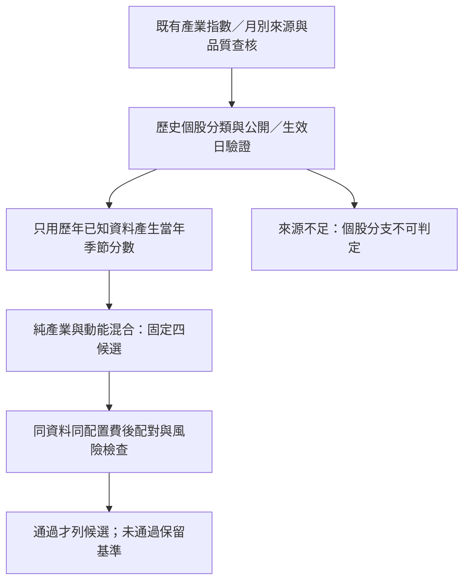

# 產業季節性：後續研究計畫 v15
2026-10-15。只規畫後續執行，沒有因產業指數曾上漲就直接加碼個股。

## 要回答的問題
同一產業是否在十月最後星期二起24交易日，持續比同期市場與該產業平常月份更強？如果有，加入原策略後是否改善費後報酬與風險？把產業長期強勢和特定月份季節性分開。

## 已有成果直接引用
既有2016–2025官方產業指數、120個月別窗口、逐年全點與v9逐年向前觀察直接引用，不重抓、不把同一份資料包裝成新證據。既有指數結果不是可交易個股策略；產業指數無個股費稅，不能與投資組合期望值混列。

## 依賴樹與完成條件

1. **來源門檻。** 建立股票代號、產業碼、有效起日／迄日、公告時間、原始來源與雜湊。先核對2023-07-03重分類，以及其他可證明的分類改變；包含47家公司公告的已知反例。不得用目前分類回填；MOPS歷史營收月份頁在2026重新出表，不能當當時分類存檔。先做來源可得性，不反覆要求已被拒絕的API，也不突破權限或付費限制。
2. **股票池門檻。** 第一層在同一目前150檔池隔離產業增量，明寫存活與選擇偏誤；第二層只有逐年上市／上櫃歷史股票池可驗證才驗證外推，不能把2016單一上市100快照說成逐年官方比賽150。
3. **指數口徑門檻。** 產業新增／重分類前的歷史不能擅自拼接。優先使用可驗證的含息指數；只有價格指數時分表標示，不和含息成果混算；大類與子類重疊須明列。分類不齊不能默默從樣本剔除後稱全市場季節性。
4. **分數固定。** 至少5個完整過往年度，當年只用決策日前已結束窗口。每產業每過往年先算『10月同期相對市場報酬－同年其他11個月份窗口的平均相對市場報酬』，再跨過往年取平均，轉成產業間百分位。至少5年且每年12月別足夠完整才可比；不足保留未知，不填中性。10月及其他月份皆沿用既有最後星期二起24交易日定義。跨年一致性與正超額年份比例作診斷，不看到結果再改公式。已看過資料，仍屬回溯驗證，非全新未見樣本外。
5. **固定候選。** 在同一配置與規則下，純產業分數，以及動能75%＋產業25%、動能50%＋產業50%、動能25%＋產業75%，共4個選股候選。純產業同分股票用過去20日成交金額排名決定，不能偷加動能。先沿用本輪25檔控制與兩種配置，共最多8個新增定義；A對照直接引用。季節性股票不足25就該窗口不可判定，不拿其他訊號偷偷補足。產業集中風險必列，不默加新的產業上限後把效果歸給季節性。
6. **評估。** 完全相同有效日期列費後勝率、24日期望值、平均獲利／虧損、有效樣本／排除原因、費用、P10、最大回撤、產業曝險與對A增量。24／48日位置區塊、多重比較家族、逐年與不重疊相位作敏感度。只有兩個比賽同期起點不能稱穩定季節性；即使十年只有十個同期點，也不能當650個獨立樣本。
7. **選擇。** 混合比重只能用當時之前已結束的訓練窗口比較，測試年鎖定；至少100訓練配對、80%基準日期覆蓋與既有風險門檻。季節性年份／公告窗口不足就不選；不以全期最高平均值挑權重，不擴增參數直到顯著。

## 本次不做與後續啟動條件
目前歷史個股分類來源未通過門檻，因此本文件是可執行的預先計畫，不是已跑完的產業選股。來源門檻通過後才能啟動四候選；否則保留指數層級觀察與清楚的缺口，不造分類。產業相對營收是更後面的獨立研究，不混入本季節性公式。LLM與正式DataPack／DPlan／交易不在本輪。
