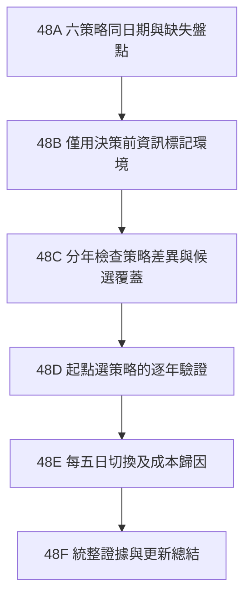

# 市場狀態與策略選擇研究計畫 v48

日期：2026-10-17。狀態：核心48A～48F已完成；四政策與原動能完全相同，沒有新增交易回測或啟動排程。沿用課程競賽資料夾、原 Notebook 與 2016～2025 資料快照。

## 要回答的問題

市場狀態是否能在投資前幫助選擇策略，而不是事後替每一段行情挑贏家？先研究開賽時選擇一種策略、持續24交易日；再分開研究比賽途中每五日是否切換。兩者均保留各策略原有五日成員調整，不能把選策略與選股混為一談。

因果脈絡假說：市場趨勢與廣度影響可選標的及共同風險；策略的持股差異影響報酬；切換產生額外交易成本。因此依序查市場資訊、候選數、持股差異、收益與成本，不預設某種環境必須使用某種策略。

## 已有證據與不能推論的部分

- 原動能與純法人在944個共同窗口同虧269次；動能虧損時法人也虧84.06%。二者不是充分分散的替代品。
- 四主要策略65%～77%的虧損窗口與同期股票池廣泛下跌共現；這是事後24日結果，不能當作當時已知訊號，也不是官方全台股熊市判定。
- 六策略共同有效日期721個；十策略交集370個明顯偏多。先前策略排序不能忽略候選不足造成的日期篩選。
- 既有v30「低波動選法人、高波動選動能」未支持通用規則，本批直接引用，不重跑相同定義，不把它當已成立結論。
- 目前150檔是現況名單的歷史子集，有存活與名單選擇偏差；正式Active Share及官方成交作廢規則仍有缺口。

## 依賴流程

### 48A：先建立公平基準

固定六策略：原動能20／60各半、純法人、法人＋50／200交叉換股、純50／200均線強度、純10／20、純10／24。

先重用已保存交易路徑，在721個共同窗口對比，不新增回測。並以原四策略944窗口作覆蓋母體：10／20有效729、未成立215；10／24有效789、未成立155。列每年有效率、缺失原因、候選數與事前市場狀態；不得把無法成立算成空手獲利或報酬0。

固定25檔只是舊實驗設定。若要取消，需另立策略版本，先依官方現金、集中度、特殊股票權重及持股數限制定義候選不足處置。不得在本批悄悄補弱勢股、忽略限制或沿用舊版名稱。

### 48B：先看市場，再看策略結果

所有特徵以交易日前一日或更早的已知資料計算；不使用當天成交均價、當日收盤、未來24日下跌比例或後來修訂資料。

第一輪僅用同一股票池可核對的價量，固定以下有限定義，不搜尋最佳門檻：

| 特徵 | 定義 | 用途 |
|---|---|---|
| 市場趨勢 | 股票池可用日報酬等權序列，前收盤相對60日均線 | 上方／下方 |
| 市場廣度 | 當時具足夠歷史的股票中，前收盤高於各自20日均線比例 | 超過50%／未超過50% |
| 波動 | 股票池日報酬過去20日標準差 | 次要描述；不先作切換條件 |
| 候選供給 | 各策略決策前符合條件股票數 | 分辨環境與策略無法成立 |

市場狀態只分三組：趨勢與廣度均正向、兩者均負向、其餘混合。名稱為強／弱／混合環境，不直接稱牛市或熊市。每日股票數及覆蓋不足則狀態未知，不以前值填補。先檢查股票池合成指數換成員造成的影響。

台灣VIX、美國VIX與景氣燈號先盤點既有研究。只有取得可驗證的歷史值、公開時點及覆蓋，才另作預先定義的增量分支；景氣燈號須依發布日而非所屬月份對齊。不得在看到本批虧損後挑恐慌門檻。核心批次不依賴這些外部資料，避免全面卡住。

### 48C：釐清市場與策略的關係

在相同日期、同一市場狀態內比較六策略的費後期望、勝率、配對差、P10與回撤。列每年全部點、候選不足、持股重疊、平均投入及費用。按時間線呈現；相鄰重疊窗口另外列為同一連續時段，不能用大量窗口聲稱有大量獨立危機。

主要統計使用費後24日平均報酬。市場跌時虧得較少、上漲時賺得較多分開報告；勝率、尾端風險及費用為必要取捨。不能只用各組最高平均值來訂規則。

### 48D：先驗證「開賽時選策略」

採逐年向前驗證：首次以2016～2018可用資料建立選擇，驗證2019；之後每年僅加入此前已結束的窗口，直至驗證2025。訓練窗口終點必須早於驗證年起點，禁止跨界24日結果流入訓練。既往2019～2025已被研究過，所以這是回溯式逐年驗證，不是全新未見樣本。

固定兩個選擇器，避免無限擴張：S1只在原動能與純法人間選擇；S2在六策略間選擇。每一環境依訓練期配對費後期望差決定，不用驗證年結果排名。採24／48日區塊不確定性檢查；資料不足、差異不明或環境未知時保留原動能。

環境至少覆蓋兩個訓練年份、六個互不重疊24日窗口，才允許估計；這只是最低可估門檻，不代表證據充足。候選需在該訓練環境至少90%日期可成立，避免靠排除弱市獲勝；不合格則不參與該環境選擇。短均線即使被選中，執行時候選不足也不能虛構完整組合：該窗口列不可執行，並另測已預定的回退至原動能版本，計入交易與訊號時間。

訓練候選相較原動能須在兩種區塊校正區間均顯示正增益，否則不切換。相近候選先選交易費用較低者；仍無法區分則保留原動能。不得以驗證期最差季度倒選規則。

### 48E：再驗證「比賽途中換策略」

僅將48D已按訓練資料鎖定的S1／S2對映，於第1、6、11、16、21交易日判斷；非每日全面換股。沿用當時真實現金及持股，按前收盤計算股數，下一個可執行交易日成交；不得拼接兩個各自從10億元起算的策略報酬或NAV。

完整記入手續費、證交稅、整千股、價格差及換股後限制。直接比較：固定原動能、固定純法人、固定其他候選、只在起點選策略、途中五日切換。先固定同一90%目標投入，隔離選策略效果；不與不同現金比率混比。降低投入屬後續獨立分支，本批不順便尋優。

### 48F：如何作結論

在開始48D前，於Notebook凍結實際比較家族、資料快照、引擎與去重鍵；新增版本加入家族校正，不另分小家族規避。主要比較為逐年驗證串接的選擇器／切換器相對固定原動能；其餘固定候選作配對對照。完整窗口以原始日期位置作24／48日區塊重抽樣，報告校正區間、年份、前後半期及剔除最差單一年敏感性。

稱為有增量證據需同時滿足：兩種區塊校正區間費後期望差均為正、至少四個具可比較資料的驗證年份不為負、剔除任何單一年後平均差仍為正，且主要比較母體可執行率至少90%。另列最差窗口回撤與P10；若比原動能更差，必須明列收益／風險取捨，不能稱全面改良。若無方法通過，結論為尚未證實市場切換有效。

總結報告新增：共同日期箱形圖（全部點、中位數異色、0%線、固定尺度）、逐年選擇及市場狀態時間線、實際切換與費用、全部未成立日期。舊報告保留並指向新結論。

## 執行邊界與續跑

依48A→48F接續；每節輸出保存後才標完成。優先查既有kernel物件metadata與必要history，不重啟、不清除、不重送執行中工作。沿用原Notebook及橋接程式，分析在kernel中執行；不建立新分析模組、專案、聊天或子代理。未知公司行動、公開時點或價格仍標不可判定。

每個實驗以定義、固定參數、資料快照與引擎版本去重。既有v30、v45～v47只引用；只有新定義或受修正資料影響的部分重算。這份計畫不代表已完成、已證明或已部署策略，也不代表重新啟用20分鐘排程。

## 執行結果

完成六策略共同802／後段721窗口比較與逐日事前狀態。105組訓練檢查無候選通過完整門檻；2019～2025全部對映回原動能。起點／五日兩選擇器按決策日核對為完全相同，引用原始交易路徑、不重算。主要評估增量0，未證實改善。完整成果：[市場狀態_六策略比較與逐年選擇_v48_2026-10-17.html](../90_%E6%AD%B7%E5%8F%B2%E5%A0%B1%E5%91%8A/%E5%A0%B1%E5%91%8A/%E5%B8%82%E5%A0%B4%E7%8B%80%E6%85%8B_%E5%85%AD%E7%AD%96%E7%95%A5%E6%AF%94%E8%BC%83%E8%88%87%E9%80%90%E5%B9%B4%E9%81%B8%E6%93%87_v48_2026-10-17.html)。台灣VIX／景氣燈號及取消25檔為未執行獨立後續分支，不列為本批完成。
