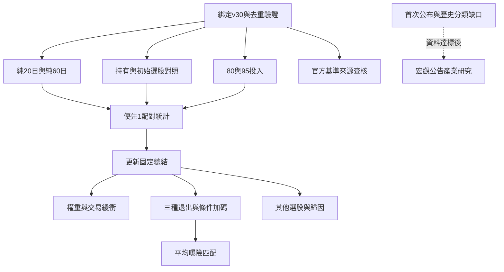

# 統一長歷史研究：續跑計畫
建立：2026-10-16。將總結報告待改進事項接成可恢復依賴佇列。此次完成計畫與節點定義，不代表新回測已開始；目前未新增或重啟排程。
## 目標與固定條件
目標是分清楚初始選股、調整頻率、投入比例及風控各自的作用；不用最高平均值直接挑贏家。主資料固定v30，行情2016/07～2025/12、2236個24日起點，現況150檔歷史可掛牌子集；保留存活偏誤與公司行動缺口。
25檔目標、整千股、原費稅、五日例行評估；單因子改動時才改對應設定。兩策略共用60日價量／公司行動及20日外資＋投信完整門檻。每項同日期配對，揭露覆蓋與失敗，無效不能填0。
## 接續順序

箭頭表示資料依賴；分析依然只用同一kernel依序執行，不並行寫Notebook。官方基準缺口不能阻擋其餘可行比較。
## 第一批：9個新方法，20124個窗口；舊基準不重跑
|節點|新增方法|對照／要回答的問題|
|---|---|---|
|選股回看|純20日、純60日，共2格|重用20／60各半；是否某個回看期更好？三者五日評估不變|
|持有與初始選股|動能初始持有、法人初始持有、成交金額排名25檔初始持有，共3格|前兩者對原五日策略隔離後續動作；後兩種家族各對成交金額排名持有，觀察初始排名作用|
|投入比例|動能80／95%、法人80／95%，共4格|90%各自重用；收益差是否只是曝險改變？現金違規不排除後假裝成功|
|官方基準來源|有限來源查核，不當作新交易格|正式總報酬基準有無覆蓋；不能把150檔研究代理稱官方指數|
成交金額對照用原始Trading_money，不用收盤×成交量偷換。持有策略只取消後續調整，日末現金、持股、公司行動、權重限制仍檢查。名目100%舊預算因負現金不列候選；接近滿倉的預算方法需要另訂，不在這批加網格。
## 比較與選擇邏輯
2016～2018作校準；主要看2019～2025，跨界不混入兩段。歷史已被看過，不能稱真正未見樣本外。
第一批13個主要配對事先固定：回看3對、持有／初始排名4對、兩家族投入各3對。24／48個原始起點位置區塊各5000次，13比較校正；同時列勝率、24日期望、平均虧損、P10、最差回撤、費稅及覆蓋。
分類而非強選：兩種校正區間的平均增量下界均>0才稱支持平均收益改善；P10與最差回撤也不劣才可稱全面改善。若收益上升但風險增加，列風險／報酬取捨，尚未替使用者設定可接受損失，不能自動選為最佳。
校準共同窗口至少100；相對對照有效日期覆蓋至少80%，否則可執行性／證據不足。跨年至少5個有20配對窗口的後段年份，其中至少三分之二平均增量為正才稱跨年一致。沒有通過就保留原基準並明寫未證實，不能擴充參數直到顯著。
## 後續分支
|分支|可接續的有限範圍|去重／前置|
|---|---|---|
|權重與小額略過|動能／法人各E0、E5、M0、M5四格|兩個E0重用，最多6新格；權重與交易緩衝分開|
|退出×加碼|原v23四退出狀態×加碼開關，共8格|動能無退出無加碼重用，最多7新格；原規則先移植驗證；不事後放寬25檔|
|曝險匹配|先只做90→95加碼對匹配固定投入|重用加碼結果；只以2016～2018平均曝險校準，不看收益，不沿用2024參數|
|其他家族與歸因|既定反轉、低波動、波動調整；重疊與虧損|先固定對照／定義，再計算；優先重用既有trace，不無限搜尋|
|景氣／公告／產業|待首次公布值、時間、全池覆蓋及歷史分類|缺資料不算績效，LLM仍暫不測；有新可驗證資料才解除阻礙|
後續各批在計算前鎖定完整對照家族與校正，不因第一批結果好壞改門檻。80→85／80→95等額外加碼組目前列延後選項，不自動擴增。
## 無人值守與恢復規則
1. 先讀機器版計畫及A策略_無人值守研究狀態.json中的unified_research_v33，再查既有kernel必要metadata與安全history。不能因舊queue標完成就停止新計畫。
2. 相同實驗鍵＋定義＋快照＋引擎版本已有結果就引用；仍正常執行只等待原session，不另送相同cell。
3. 單一Notebook寫入者。計算直接在既有kernel，程式與輸出保存Notebook；不重啟、不清除，不輸出憑證或寫DB。
4. 節點先保存結果與驗證，再標completed；記錄current_node、cellindex與tool session以恢復。來源最多三次有意義嘗試，缺口不偽造，不阻斷其他可行節點。
5. 每20分鐘若有檢查，僅是喚醒／恢復，不是執行期限。這份計畫本身沒有建立或啟用排程，也不代表已有後台程式在跑。
6. 完成一個小cell不是結束理由；接著做依賴已滿足的可行節點。全部可行節點完成，或其餘都遇到已確認外部阻礙時才結束。
## 完成標準與位置
主資料與引擎雜湊、候選定義、去重鍵、依賴及13主要對照在同名JSON。每批保存統計、全部窗口圖與選擇理由，再更新既有總結Markdown及HTML。保留中位數、0線、共同尺度與同日期分母。
目前下一節點：bind_and_validate。第一批9個新格尚未執行。後續對話要求「繼續」時，依本計畫接續，不需要重新盤點或重跑基準。